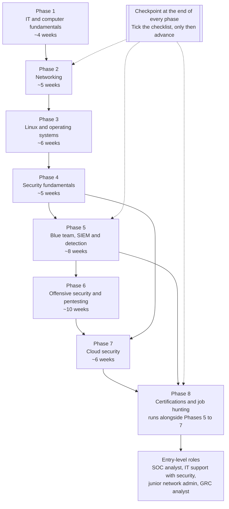
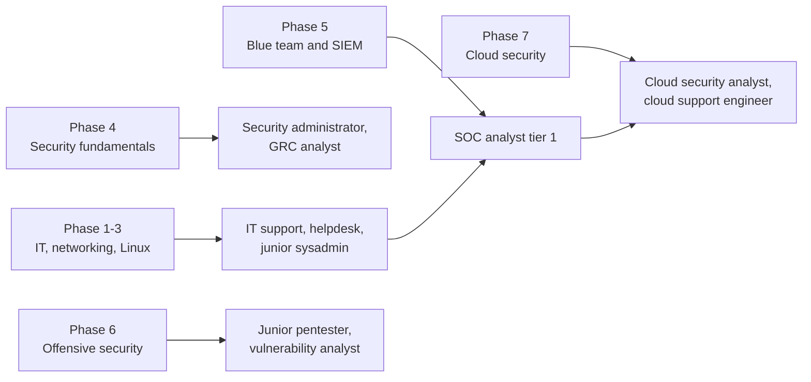

# Cybersecurity Roadmap 2026: Zero to Job Ready

[](https://github.com/tariqsumatri82/cybersecurity-roadmap-2026)
[](https://github.com/tariqsumatri82/cybersecurity-roadmap-2026/network/members)
[](LICENSE)
[](tools/check_links.py)
[](https://github.com/tariqsumatri82/cybersecurity-roadmap-2026/commits/main)

**A free, eight-phase path from "I know nothing about IT" to "I can pass an entry-level cybersecurity interview", with a checkpoint at the end of every phase, hands-on exercises with the real commands, and a progress checklist you can tick off in your own fork.**

No paid courses are required. Every learning resource below is free, or free at a usable tier, and every link in this file is checked by the script in [`tools/check_links.py`](tools/check_links.py).

Built from 15+ years of industry experience by [Tariq Sumatri](https://github.com/tariqsumatri82).

---

## Is this roadmap for you?

**This is for you if:**

- You are starting from zero (or from IT support / helpdesk) and want a single ordered path instead of a pile of 40-hour video courses.
- You can study roughly 10 hours a week and want to know what to do *this* week, not in general.
- You want hands-on proof you can show an employer (labs, notes, writeups) alongside any certification.
- You are self-funding, so "free tier" actually matters to you.

**This is not for you if:**

- You already work in security and want advanced red-team content. Phase 6 is a foundation, not a replacement for OffSec-style lab time.
- You want a certificate that guarantees a job. No certificate does that, and this roadmap will not pretend otherwise.
- You want to click "enrol" once and be handed a career. This is a path, not a course.

**An honest note on outcomes:** nobody can promise you a job, a salary band, or a start date. What this roadmap can do is remove the two biggest causes of failure for self-taught people: not knowing what to learn next, and never practising on anything real. Local job markets differ enormously, so treat the job-hunt phase as a method you run locally, not a promise.

**Estimated effort.** The eight phases add up to roughly **450–600 hours** of study and hands-on practice. That is arithmetic over the phase estimates below, not a surveyed average. At ~10 hours a week that is about a year; at ~20 hours a week, about six months. Certification exam preparation sits *on top* of that number (Phase 8 explains how to fold it in). Source: the per-phase estimates in this file; your mileage will vary with your starting point.

---

## What you get

| | |
|---|---|
| **8 phases, in order** | IT fundamentals → networking → Linux and operating systems → security fundamentals → blue team and SIEM → offensive security → cloud security → certifications and job hunting |
| **A checkpoint per phase** | Concrete "you are ready to move on when..." criteria, so you never guess whether you can advance |
| **Master progress checklist** | One markdown task list covering the whole path, tickable in your fork ([jump to it](#master-progress-checklist)) |
| **30+ hands-on exercises** | Actual commands and steps: Packet captures, permission finding, log triage, SIEM alerts, lab scans, IAM auditing |
| **Link-checked resources** | Named courses, labs and vendor docs — free ones only, verified reachable (see [link checking](#link-checking)) |
| **An honest certification guide** | Real cert names, real providers, the level each suits, and what to actually check before paying ([jump to it](#phase-8-certifications-and-job-hunting)) |
| **Interview prep** | Entry-level roles worth targeting, the questions you will be asked, and how to answer with lab evidence |
| **Common mistakes** | The specific reasons people quit this path in month three, and the cheap fix for each ([jump to it](#common-mistakes-and-why-people-quit)) |
| **A link checker you can re-run** | [`tools/check_links.py`](tools/check_links.py) — Python standard library only, no install step |

---

## How to use this repo

1. **Fork it.** Click **Fork** (top right) so you get your own copy with your own commit history. Your ticks are then your progress record, and a GitHub commit history of steady learning is itself a portfolio artefact recruiters can look at.
2. **Read this README once, end to end.** 20 minutes. You need the shape of the path before you start, not the detail.
3. **Work phase by phase, in order.** Do not skip Phase 2 (networking) or Phase 3 (Linux) because they look boring. Almost everyone who quits this field skipped them and then found every later topic confusing.
4. **Tick the boxes as you go.** In the [master checklist](#master-progress-checklist), change `- [ ]` to `- [x]` and commit. Small visible wins are the only thing that keeps month 3 survivable.
5. **Do the exercises for real.** Reading about Wireshark is not the same as reading a packet capture. The exercises say exactly what to run.
6. **Write down what you did.** One short note per exercise, per lab, per box you tick. By Phase 8 your notes *are* your interview material.
7. **Pull updates.** This file improves over time (see [Contributing](CONTRIBUTING.md)). `git pull` on your fork's upstream, or re-read the changed section, so you keep the newest resources.
8. **Check your links any time.** `python3 tools/check_links.py` re-verifies every URL in this README and prints the ones that failed.

**Equipment you actually need.** Any machine with ~8 GB RAM, ~60 GB free disk and virtualisation enabled in the BIOS. Windows, Linux or macOS all work. A used business laptop is fine. You do **not** need a "hacking laptop", a paid cloud account, or a home lab full of hardware — Phases 1–6 run entirely in virtual machines and browser-based labs, and Phase 7 uses free tiers with a teardown rule (delete what you create).

---

## The path at a glance



The dashed line is the rule that matters: **each phase ends with a checkpoint. Finish it before you move on.** If a checkpoint fails, repeat the last exercise of the phase rather than starting the next one — the phases build on each other and skipping ahead is how people end up stuck in Phase 6 with a lab they cannot explain.

Where each phase tends to lead, as a rough map (not a promise — titles and requirements vary by employer and country):



---

## Master progress checklist

Copy this into your own notes, or tick it directly in your fork. It mirrors the eight phases below — nothing here that the phases do not explain.

### Phase 1: IT and computer fundamentals

- [ ] I can name the main parts of a computer and say what each does (CPU, RAM, storage, BIOS/UEFI, OS)
- [ ] I can read my own machine's IP address, default gateway, DNS servers, CPU, RAM and disk from the command line
- [ ] I can explain, without notes, what happens between typing a URL and seeing a page
- [ ] I have drawn my own home network on one page
- [ ] I can convert decimal to binary and back by hand (for subnetting later)

### Phase 2: Networking

- [ ] I can describe the OSI model and the TCP/IP model in my own words, layer by layer
- [ ] I can explain IP addressing, subnet masks and CIDR notation
- [ ] I can explain the difference between TCP and UDP and give one use for each
- [ ] I can name the common ports and protocols: 22, 53, 80, 443, 445, 3389
- [ ] I have captured live traffic in Wireshark and read a TCP three-way handshake in it
- [ ] I can work out the host range of a /26 subnet without a calculator

### Phase 3: Linux and operating systems

- [ ] I can navigate, create, move and delete files without touching a mouse
- [ ] I can explain `chmod 755` and `chmod 640` in words
- [ ] I can find users, groups and permissions, and I know what `sudo` really does
- [ ] I have finished OverTheWire Bandit levels 0 to 15
- [ ] I can read processes, listening ports and services with `ps`, `ss` and `systemctl`
- [ ] I have used `journalctl` or `/var/log/auth.log` to answer a question about failed logins
- [ ] I can do basic PowerShell and I know what Active Directory is for

### Phase 4: Security fundamentals

- [ ] I can explain the CIA triad with an example of an attack on each part
- [ ] I can explain the difference between hashing and encryption, and give a use for each
- [ ] I can describe phishing, malware, ransomware, DDoS and man-in-the-middle attacks
- [ ] I can explain least privilege, defence in depth and zero trust
- [ ] I understand what a firewall, VPN, IDS and IPS each do, and where they sit
- [ ] I have triaged a real phishing email's headers for SPF, DKIM and DMARC results
- [ ] I can name the OWASP Top 10 categories and what each one means

### Phase 5: Blue team, SIEM and detection

- [ ] I have a working SIEM or log analysis tool running in my own lab
- [ ] I have generated failed-login activity on purpose and found the alert it produced
- [ ] I have written and run at least three detection searches
- [ ] I have analysed a real malware traffic capture and named the C2 domain
- [ ] I understand what MITRE ATT&CK is and can map one behaviour to a technique ID
- [ ] I have completed at least one blue-team challenge on a free platform
- [ ] I can explain the life of a security alert from detection to closure

### Phase 6: Offensive security and pentesting

- [ ] I have an isolated lab with at least one deliberately vulnerable target
- [ ] I can run an Nmap scan and explain every line of the output
- [ ] I have completed the PortSwigger Academy apprentice labs for at least one vulnerability class
- [ ] I have used an intercepting proxy to modify a live request
- [ ] I have cracked a hash in a lab and can explain why the password was weak
- [ ] I have written a mini penetration test report with findings, severity and fixes
- [ ] I understand scope, authorisation and the law around testing, and I never test systems I do not own

### Phase 7: Cloud security

- [ ] I can explain shared responsibility and what it means for me as a defender
- [ ] I have a free-tier cloud account secured: MFA on, no root access keys, least-privilege user
- [ ] I can audit who has access to what with identity tooling and the CLI
- [ ] I have scanned a container image and read the results
- [ ] I have checked a Kubernetes cluster's permissions from inside it
- [ ] I have turned on cloud logging and found something useful in it
- [ ] I tore down everything I created (no surprise bill)

### Phase 8: Certifications and job hunting

- [ ] I know which certifications my target job ads actually ask for, counted by hand
- [ ] I checked the vendor's official page for current pricing and exam requirements of any cert I plan to sit
- [ ] I have 3 written lab or project writeups I can show
- [ ] I have a CV tailored to one specific job title, with evidence links in it
- [ ] I can answer the interview questions in Phase 8 out loud, in under two minutes each
- [ ] I have applied to a first batch of roles rather than waiting until I feel ready

---

## Phase 1: IT and computer fundamentals

**Estimated time: 4 weeks**, roughly 30–40 hours including practice.

**Why it matters.** Every later phase is a specialisation of this one. If you cannot say why RAM behaves differently from disk, or what a UEFI setting does, then disk forensics, virtual machines and cloud storage all stay mysterious. Interviews at entry level test this constantly, because it filters out people who learned the vocabulary without the machine behind it.

**What you will learn**

- Computer hardware: CPU, RAM, storage types, motherboard, BIOS/UEFI, boot order
- Operating system basics: processes, memory, filesystems, users and drivers
- Virtualisation: what a hypervisor does, virtual machines, snapshots
- Binary, decimal and hexadecimal, and why computers care
- The internet at 10,000 feet: IP addresses, DNS, DHCP, NAT, routers, switches, firewalls
- OSI and TCP/IP models
- Common protocols: HTTP/HTTPS, SSH, FTP, DNS

**Checkpoint — you are ready to move on when:**

- You can explain what happens between typing a URL and seeing a page, in your own words
- You can name your own machine's IP, gateway, DNS servers, CPU, RAM and disk without looking them up in a settings GUI
- You can convert 192 to binary and back
- You have drawn your home network on one page and can label every device

**Free resources**

- [Professor Messer — YouTube channel](https://www.youtube.com/@professormesser) — the most widely used free video library for CompTIA fundamentals; watch the A+ and Network+ playlists for Phase 1 and 2.
- [CS50x — Harvard, free](https://cs50.harvard.edu/x/) — an actual computer science course, free to take, with problem sets; the most rigorous free grounding available in how computers and code work.
- [Cisco Networking Academy](https://www.netacad.com) — free introductory networking and IT courses from Cisco, with labs in a browser.
- [freeCodeCamp](https://www.freecodecamp.org/learn/) — free, structured, with certificates; useful for the scripting and web basics you will need later.
- [MDN — HTTP overview](https://developer.mozilla.org/en-US/docs/Web/HTTP/Overview) — the reference for how requests and responses actually work; you will come back to this in Phase 6.

**Hands-on exercises**

1. **Inventory your own machine from the command line.** On Windows: `ipconfig /all`, `systeminfo`, `wmic logicaldisk get size,freespace,caption`. On Linux/macOS: `ip -br a`, `lsblk`, `free -h`, `lscpu`, `uname -a`. Write down IP, gateway, DNS servers, CPU model, RAM, disk and OS build, and next to each one write what it is for.
2. **Trace one web request by hand.** Run `nslookup github.com` (or `dig +short github.com`), then `ping github.com`, then `tracert github.com` on Windows or `traceroute github.com` on Linux/macOS, then `curl -vI https://github.com`. For each of the four commands, write which OSI layer it demonstrates and what changed between the steps. This single exercise answers the most common entry-level interview question.
3. **Draw your home network.** One page: ISP, router, every connected device, and which addresses are private. Keep it; you will compare it to your lab network in Phase 2.
4. **Install a hypervisor and one virtual machine.** VirtualBox is free and cross-platform; create an Ubuntu or Debian VM, take a snapshot, then deliberately break something and restore the snapshot. You have now met the tool (snapshots) that makes the rest of this roadmap safe to practise in.

---

## Phase 2: Networking

**Estimated time: 5 weeks**, roughly 40–50 hours.

**Why it matters.** Security work is largely the study of traffic: what should be on the wire, what should not, and who is talking to whom. Analysts who can read a packet capture and explain it are rarer, and better paid, than people who can only click through a dashboard. Subnetting and protocol knowledge also show up in nearly every technical interview, including non-networking roles.

**What you will learn**

- The OSI model and TCP/IP model, layer by layer, mapped to real tools
- IP addressing, subnets, CIDR notation, private versus public ranges (RFC 1918)
- TCP versus UDP, ports, the three-way handshake, flags
- DNS from the inside: records, resolution, caching; DHCP, NAT
- Network devices: routers, switches, firewalls, load balancers, proxies, and where each one sees traffic
- Packet capture and analysis with Wireshark and tcpdump
- Basic scanning and what it tells you

**Checkpoint — you are ready to move on when:**

- You can describe each OSI layer and name one device or protocol that lives there
- You can calculate the usable host range of a /26 without a subnet calculator
- You can read a TCP three-way handshake and a DNS query in a capture file
- You can explain the difference between a switch and a router to a non-technical person
- You know what port 3389 and port 445 are, and why defenders care about them

**Free resources**

- [Professor Messer — Network+ course](https://www.youtube.com/@professormesser) — free, complete, exam-aligned video course for this whole phase.
- [Cisco Networking Academy — Networking Basics](https://www.netacad.com/courses/networking-basics) — free, with interactive labs; pairs well with Messer's videos.
- [Wireshark — official documentation](https://www.wireshark.org/) — download plus the user guide; the sample capture files in the docs are the fastest way to learn reading traffic.
- [RFC 1918 — Address Allocation for Private Internets](https://www.rfc-editor.org/rfc/rfc1918) — the primary source for private IP ranges. Read the real RFC; it is short, and interviewers notice people who can cite one.
- [Nmap reference guide](https://nmap.org/book/man.html) — the manual you will use again in Phase 6.
- [TryHackMe — Pre-Security path](https://tryhackme.com) — free rooms covering networking basics in a browser, if you want guided practice instead of videos.

**Hands-on exercises**

1. **Capture and read real traffic.** Install Wireshark, start a capture on your active interface, then browse to a site. Apply the display filters `dns`, then `tcp.flags.syn == 1`, then `http.request`. Answer in writing: which DNS server answered, what IP the site resolved to, and which three packets opened the TCP connection. Bonus: use `tcpdump -i any -n port 53` (Linux) to see the same activity as raw text.
2. **Subnet by hand, then verify with code.** Given `192.168.10.0/24`, work out the network address, broadcast and usable host range of the `/26` subnets on paper. Then check yourself with the standard library, no installs needed:

   ```bash
   python3 -c "
   import ipaddress
   net = ipaddress.ip_network('192.168.10.0/26')
   print(net, net.network_address, net.broadcast_address)
   print('first hosts:', list(net.hosts())[:3])
   "
   ```

   Repeat for `/27`, then for a `/26` carved out of `10.0.0.0/16`. If `ipcalc` is available on your system, `ipcalc 192.168.10.0/26` does the same thing.
3. **Scan only your own lab.** In your VM-only host-only or internal network (never a network you do not own or have written permission to test), find the lab subnet and run:

   ```bash
   sudo nmap -sn 192.168.56.0/24        # discovery: what is alive
   sudo nmap -sV -p 22,80,443 192.168.56.10   # what services are exposed
   ```

   Write down every host and every open port, and explain what each service is. **Rule that never bends:** scanning or touching systems you do not own or lack written authorisation for is a crime in most jurisdictions. Labs only, always.
4. **Read RFC 1918 and check your own addresses.** Classify every IP you found in the previous exercise as private or public, and say which private range it belongs to.

---

## Phase 3: Linux and operating systems

**Estimated time: 6 weeks**, roughly 50–60 hours.

**Why it matters.** Most servers, most security tooling and every serious lab environment runs on Linux, and most enterprises run on Windows with Active Directory. You need both, and you need the command line for both. This is the phase where "I can follow a tutorial" turns into "I can work out what to do next".

**What you will learn**

- Linux filesystem layout, navigation and file operations
- Users, groups, ownership and permissions: `chmod`, `chown`, `sudo`, SUID
- Package management, services and logs: `apt`, `systemctl`, `journalctl`, `/var/log`
- Process and resource management: `ps`, `top`, `kill`, `ss`
- Shell basics for automation: pipes, redirection, `grep`, `find`, `xargs`, a first small script
- Windows essentials: PowerShell, Active Directory, the Registry, event logs
- Virtual machine networking: NAT, host-only, bridged, and why it matters for lab isolation

**Checkpoint — you are ready to move on when:**

- You can move around, create, search and edit files without using a mouse
- You can explain `chmod 755` and `chmod 640` in words, and say why SUID binaries are a security risk
- You have finished OverTheWire Bandit levels 0 to 15
- You can find what is listening on a port and which process owns it
- You can answer "how many failed SSH logins yesterday?" from the logs
- You can run basic PowerShell and explain what a domain controller does
- You have built an isolated two-VM lab and proven the VMs cannot reach each other except where you allow it

**Free resources**

- [Linux Upskill Challenge](https://linuxupskillchallenge.org/) — free, month-long course of daily lessons that take you from the shell basics to administering a remote Linux server; a good first pass before Bandit.
- [OverTheWire — Bandit](https://overthewire.org/wargames/bandit/) — learn Linux by solving 30+ escalating challenges over SSH. This is the single most recommended Linux exercise in the field, and for good reason.
- [The Linux Command Line (free, open book)](https://linuxcommand.org/tlcl.php) — a complete, well-written book you can read free online; use it as the reference when a concept in Bandit does not land.
- [Ubuntu tutorials — command line for beginners](https://ubuntu.com/tutorials/command-line-for-beginners) — a gentle official introduction if the shell is completely new.
- [Linux man pages online](https://man7.org/linux/man-pages/) — where to check what a flag actually does. Learning to read `man` pages is a career skill; guessing is not.
- [TryHackMe — Linux Fundamentals](https://tryhackme.com) — browser-based guided Linux rooms, free, no VM needed.
- [Microsoft Learn — PowerShell 101](https://learn.microsoft.com/en-us/powershell/scripting/learn/ps101/01-getting-started) — free official introduction to PowerShell.
- [Microsoft Learn — Active Directory Domain Services](https://learn.microsoft.com/en-us/windows-server/identity/ad-ds/active-directory-domain-services) — the official overview of AD; read it for concepts, then build a domain in your lab if you have the RAM.

**Hands-on exercises**

1. **OverTheWire Bandit, levels 0 to 15.** Do it in a terminal, and keep a plain text file with one line per level: the command you used and why it worked. Do not paste walkthroughs; if you are stuck for more than 20 minutes, read *only* the hint for that level. Your notes file becomes a reference you will actually use.
2. **Permissions and SUID, on your own VM.** Create a test user, a file and a directory, then work through:

   ```bash
   sudo useradd -m testuser
   sudo chmod 640 /tmp/secret.txt && ls -l /tmp/secret.txt
   sudo chown testuser:testuser /tmp/secret.txt
   find / -perm -4000 -type f 2>/dev/null   # SUID binaries
   ```

   Write down what each octal digit in `640` means, and pick two SUID binaries from the output and explain why a set-uid binary is a privilege-escalation risk if it is misconfigured.
3. **Log triage, answering a question.** On an Ubuntu/Debian VM with SSH installed:

   ```bash
   sudo grep -c "Failed password" /var/log/auth.log
   sudo journalctl -u ssh --since "24 hours ago" | grep -i fail | tail -20
   ss -tulpn                  # what is listening right now
   systemctl list-units --type=service --state=running
   ```

   Then answer, in writing: which account was targeted, from which IP, and what you would do first if this were a real server.
4. **Build the isolated lab you will use for the rest of the roadmap.** Two VMs (for example Ubuntu Server and Kali Linux) in VirtualBox on an internal or host-only network, snapshots taken before each experiment, and no bridged adapter. Prove isolation: from one VM, try to reach the other's guest-only services, then flip a setting and show the difference. Everything in Phases 4 to 7 assumes this lab exists.

---

## Phase 4: Security fundamentals

**Estimated time: 5 weeks**, roughly 40–60 hours.

**Why it matters.** This is where you stop being an IT person who likes security and start being able to reason about attacks and defences in the same breath. The concepts here are the shared vocabulary of every interview, every incident call and every certification exam in Phase 8.

**What you will learn**

- The CIA triad, and what an attack on each part looks like in practice
- Threat types: phishing, malware, ransomware, DDoS, man-in-the-middle, supply-chain attacks
- Cryptography in practice: symmetric versus asymmetric encryption, hashing, salting, certificates, TLS
- Authentication and authorisation: MFA, password storage, session handling, least privilege
- Defensive architecture: firewalls, VPNs, IDS/IPS, segmentation, defence in depth, zero trust
- Risk language: vulnerability, threat, risk, likelihood, impact, and why mitigation is a business decision
- Frameworks and standards you will meet at work: NIST CSF, CIS Benchmarks, OWASP Top 10, MITRE ATT&CK
- Social engineering and the human layer

**Checkpoint — you are ready to move on when:**

- You can explain the CIA triad with a real attack example for each letter
- You can explain the difference between hashing and encryption, and when to use each
- You can describe a phishing attack from both the attacker's and the victim's side
- You can explain how TLS protects a connection, and what a certificate actually proves
- You can explain least privilege, defence in depth and zero trust to a non-technical colleague
- You can name five OWASP Top 10 categories and what each one means
- You know what MITRE ATT&CK is for, and you have looked up one technique in it

**Free resources**

- [Google Cybersecurity Professional Certificate](https://www.coursera.org/professional-certificates/google-cybersecurity) — free to audit (paid certificate optional); a well-structured introduction to the concepts in this phase.
- [IBM SkillsBuild — cybersecurity courses](https://skillsbuild.org) — free courses including security fundamentals, with completion badges.
- [TryHackMe — Pre-Security and Cyber Security 101 paths](https://tryhackme.com) — free rooms that turn each concept into a small practical task.
- [OWASP Top 10](https://owasp.org/www-project-top-ten/) — the canonical list of web application risks; you will use it constantly from Phase 6 onwards.
- [MITRE ATT&CK](https://attack.mitre.org/) — the database of real adversary techniques; skim the Enterprise tactics and pick three techniques to read properly.
- [MITRE ATT&CK — getting started](https://attack.mitre.org/resources/getting-started/) — how to use ATT&CK without drowning in it.
- [NIST Cybersecurity Framework](https://www.nist.gov/cyberframework) — the vocabulary of organisational security programmes, and a common interview topic in governance roles.
- [CISA — cybersecurity best practices](https://www.cisa.gov/topics/cybersecurity-best-practices) — free, practical, authoritative guidance from a national agency.
- [CyberChef](https://gchq.github.io/CyberChef/) — a browser tool for encoding, decoding, hashing and analysing data; invaluable for exercises and CTFs.

**Hands-on exercises**

1. **Prove to yourself that hashing and encryption are different.** In a Linux VM:

   ```bash
   printf 'hello' | sha256sum
   printf 'hellp' | sha256sum          # one character changed, hash completely different
   openssl enc -aes-256-cbc -pbkdf2 -salt -in notes.txt -out notes.enc -pass pass:training
   openssl enc -d -aes-256-cbc -pbkdf2 -in notes.enc -out notes.back -pass pass:training
   ```

   Write down: why the two hashes share no visible similarity, why a hash cannot be "decrypted", and why storing passwords as plain hashes is still a bad idea (look up salting and compare with how modern systems store them).
2. **Triage a phishing email properly.** Take a real spam or the sample your mail provider quarantined, and examine the full raw headers:
   - Run them through [Google's Messageheader analyser](https://toolbox.googleapps.com/apps/messageheader/) and record the SPF, DKIM and DMARC results.
   - Check the sender's domain DMARC record yourself: `dig txt _dmarc.example.com` (replace `example.com` with the real sender domain).
   - Write a three-line verdict as if for a ticket: what it was, what the evidence is, and what you told the user to do.
3. **Map attacks to the CIA triad and to ATT&CK.** Pick five recent vulnerabilities from the [NVD](https://nvd.nist.gov/) or five ATT&CK techniques, and for each one write which part of the triad it threatens, how likely it is, and one control that reduces the risk. This is the reasoning you will be asked to demonstrate in interviews.
4. **Turn theory into a small artefact.** Write a one-page "top five risks for a 20-person company" memo with a mitigation and an owner for each. No tools required — the writing is the exercise, and it is exactly what GRC interviews ask for.

---

## Phase 5: Blue team, SIEM and detection

**Estimated time: 8 weeks**, roughly 80–100 hours.

**Why it matters.** Most entry-level security jobs are blue team jobs. There are far more SOC analyst openings than pentester openings, and detection work is where the majority of a security team's money and headcount goes. It is also the phase people skip, because offensive security is more glamorous on YouTube — which is precisely why showing up with SIEM and log skills makes you stand out.

**What you will learn**

- How a SOC is organised: tier 1 triage, escalation, IR handoff, shift work in reality
- Log sources that matter: Windows event logs, Sysmon, Linux auth logs, web server logs, firewall and proxy logs, DNS logs, cloud audit logs
- SIEM concepts and hands-on: ingestion, parsing, correlation rules, alerts, dashboards, false positives
- Detection engineering: writing a rule, testing it, tuning out noise, documenting it
- Endpoint detection and response basics, and host-based telemetry
- Network detection: IDS/IPS, Zeek and Suricata-style analysis, threat hunting from a PCAP
- Incident response fundamentals: preparation, identification, containment, eradication, recovery, lessons learned
- Mapping detections to MITRE ATT&CK

**Checkpoint — you are ready to move on when:**

- You have a SIEM or log platform running in your lab and you have ingested at least two different log sources into it
- You have triggered a failed-login burst and found the resulting alert without help
- You have written three detection searches or rules, and tuned at least one to cut false positives
- You have analysed a real malware traffic capture and identified the C2 domain from it
- You can map a behaviour you observed to a MITRE ATT&CK technique ID
- You can describe what you would do in the first 30 minutes of a ransomware incident, in order
- You have completed at least one free blue-team challenge end to end

**Free resources**

- [LetsDefend](https://letsdefend.io/) — free tier with a simulated SOC, alert triage scenarios and a dashboard to work in; the closest free thing to a real tier-1 day.
- [CyberDefenders](https://www.cyberdefenders.org/) — free blue-team CTF challenges across network forensics, endpoint forensics, malware analysis and SIEM.
- [Blue Team Labs Online](https://blueteamlabs.online/) — free challenges focused on investigation and reporting; several are permanently free.
- [malware-traffic-analysis.net](https://www.malware-traffic-analysis.net/) — free, regularly updated real-world PCAPs with accompanying exercises. Read the site's note on how to use them before you start.
- [Splunk — free courses](https://www.splunk.com/en_us/training/free-courses/overview.html) — free official training for the most common commercial SIEM; useful even if your lab runs something else.
- [Elastic — free training](https://www.elastic.co/training/free) — free official courses for Elastic Security, a common open-source-adjacent SIEM stack.
- [Wazuh](https://wazuh.com/) — free, open-source SIEM/XDR you can run in your own lab; the fastest way to get hands-on with real alerting.
- [SigmaHQ — Sigma rules](https://github.com/SigmaHQ/sigma) — the community detection rule format; reading real rules teaches detection engineering faster than any course.
- [Security Onion](https://securityonionsolutions.com/) — free network security monitoring platform bundling Zeek, Suricata and more; heavy, but a genuine lab-grade blue-team stack.
- [Zeek documentation](https://docs.zeek.org/en/master/) — network analysis framework used in real SOCs; skim the logs it produces and what each one means.
- [MISP project](https://www.misp-project.org/) — open-source threat intelligence platform; useful for understanding indicators of compromise beyond a list in a spreadsheet.
- [CISA — Known Exploited Vulnerabilities catalogue](https://www.cisa.gov/known-exploited-vulnerabilities-catalog) — the list of vulnerabilities actually being exploited; a good source of realistic hunting priorities.
- [Microsoft Learn — free security training](https://learn.microsoft.com/en-us/training/) — free modules on Defender, Sentinel and identity, useful for the vendor-heavy side of blue team.

**Hands-on exercises**

1. **Stand up a SIEM and generate your own alert.** Run Wazuh (single node, Docker or the OVA) in your lab and monitor a Linux VM. Then deliberately create the event:

   ```bash
   for i in $(seq 1 10); do ssh baduser@192.168.56.10 2>/dev/null; done
   ```

   Find the resulting authentication-failure alert in the dashboard, record the rule ID, the log line that triggered it, and write down two ways you would reduce false positives on that rule. Getting from "an event happened" to "an alert fired because of this rule" is the core tier-1 skill.
2. **Write three detection searches and one Sigma rule.** Using Splunk Free or Elastic, ingest a log file (auth logs, or a sample web access log if you do not have one yet) and write searches for: failed logins by source IP, a spike in a single source IP's traffic, and one suspicious command execution pattern. Then write the same idea for the failed-login case as a [Sigma](https://github.com/SigmaHQ/sigma) rule and compare it with the community rules for similar behaviour.
3. **Hunt through a real PCAP.** Download one PCAP from [malware-traffic-analysis.net](https://www.malware-traffic-analysis.net/), analyse it in Wireshark, and answer: what was downloaded, what domain or IP was the command-and-control, and which MITRE ATT&CK technique best describes the delivery. Write it up in the format of a short incident note (what happened, evidence, impact, next steps).
4. **Complete a blue-team challenge and write the report.** Pick one free challenge from CyberDefenders or Blue Team Labs and produce a writeup with answers *and* the reasoning for each. The writeup is the artefact — interviewers ask "walk me through an investigation" and this is your answer.
5. **Talk through an incident timeline.** Write a 10-step timeline for a ransomware incident at a mid-sized company, from the first alert to post-incident review, and note which step you would personally be responsible for as a tier-1 analyst. Discussing boundaries honestly is a strength, not a weakness.

---

## Phase 6: Offensive security and pentesting

**Estimated time: 10 weeks**, roughly 100–120 hours.

**Why it matters.** Understanding how something is broken is how you learn to defend it, and hands-on offensive skill is what separates people who can talk about security from people who can demonstrate it. It is also a smaller job market than blue team — treat this phase as both a career path and the best possible training for defending.

**Read this first.** Only ever test systems you own or have explicit written permission to test. Practising on real systems without authorisation is a criminal offence in most countries, ends careers before they start, and no employer will accept "I was learning" as a defence. Everything below happens in your own lab or a platform whose whole purpose is to be attacked.

**What you will learn**

- Penetration testing methodology: scoping, rules of engagement, reconnaissance, enumeration, exploitation, privilege escalation, reporting
- Reconnaissance: passive versus active, OSINT, and mapping an attack surface
- Scanning and enumeration with Nmap, and reading the output properly
- Web application testing: the OWASP Top 10 in practice, authentication and access-control flaws, injection, and how to test them methodically
- Using an intercepting proxy (Burp Suite Community or ZAP) to understand and modify requests
- Exploitation frameworks and password attacks in a lab: Metasploit, Hydra, John the Ripper, Hashcat
- Post-exploitation basics: privilege escalation concepts, lateral movement concepts, persistence concepts
- Reporting: severity scoring, reproduction steps, remediation advice, executive summary

**Checkpoint — you are ready to move on when:**

- You can plan and run a scan against a lab host and explain every service you found
- You have completed the apprentice-level PortSwigger labs for at least two vulnerability classes without a walkthrough
- You have modified a live request with a proxy and explained the result
- You have cracked a lab hash and explained why the password was weak and what policy would have helped
- You have written a penetration test report with findings, severity scores and fixes
- You can explain what is in scope in a rules-of-engagement document, and why it exists

**Free resources**

- [PortSwigger Web Security Academy](https://portswigger.net/web-security) — free, by the makers of Burp Suite, with hundreds of labs; the best free web security training that exists.
- [PortSwigger — all labs](https://portswigger.net/web-security/all-labs) — the full lab index, filterable by topic and difficulty; use it to plan your practice rather than wandering.
- [OWASP Juice Shop](https://owasp.org/www-project-juice-shop/) — a deliberately vulnerable modern web app, free, with a built-in scoreboard of challenges.
- [OWASP Top 10](https://owasp.org/www-project-top-ten/) — the map for the web labs above.
- [DVWA — Damn Vulnerable Web Application](https://github.com/digininja/DVWA) — free, classic, deliberately vulnerable app; good for seeing the same bug at low, medium and high difficulty.
- [Hack The Box](https://www.hackthebox.com) — free tier including Starting Point machines, which guide you through a first machine end to end.
- [TryHackMe](https://tryhackme.com) — free rooms for offensive basics and tool introductions; useful when you want structure rather than a bare machine.
- [picoCTF](https://picoctf.org/) — free beginner-friendly CTF with a permanent practice archive; the gentlest on-ramp to capture-the-flag skills.
- [pwn.college](https://pwn.college/) — free, university-grade, hands-on offensive security course material with automatic grading; demanding and excellent.
- [OverTheWire — Natas](https://overthewire.org/wargames/natas/) — free web security wargame; teaches server-side web bugs through puzzle solving.
- [SecLists](https://github.com/danielmiessler/SecLists) — the standard collection of wordlists and payload lists used in real engagements and labs.
- [PayloadsAllTheThings](https://github.com/swisskyrepo/PayloadsAllTheThings) — a huge, well-maintained reference of payloads and bypass techniques, with explanations.
- [Nmap reference guide](https://nmap.org/book/man.html) — the authoritative manual; use the examples section as your exercise source.
- [Kali Linux tools](https://www.kali.org/tools/) — descriptions of what each tool in Kali is for; read the three you use most before moving on.
- [Exploit Database](https://www.exploit-db.com/) — real public exploits and advisories; read them to understand what a vulnerability looks like when it is weaponised.
- [FIRST — CVSS calculator](https://www.first.org/cvss/calculator/4.0) — score your findings the way a real report does; download the specification if you want the reasoning behind a score.
- [Crack Me If You Can / password cracking practice](https://crackmes.one/) — free downloadable reverse-engineering and cracking challenges for practice outside a live target.
- [CyberChef](https://gchq.github.io/CyberChef/) — essential for decoding payloads and obfuscated strings during CTFs.

**Hands-on exercises**

1. **Run an authorised scan in your lab and write it up as findings.** With your target VM isolated:

   ```bash
   sudo nmap -sV -sC -oA labscan 192.168.56.20
   sudo nmap -p- --min-rate 1000 192.168.56.20
   ```

   Then produce five findings in this format: what the service is, why it is a risk, evidence (the exact output line), severity with a CVSS score, and the fix. This is the deliverable employers care about — the scan is the easy part.
2. **Juice Shop with a proxy.** Run it locally (`docker run --rm -p 3000:3000 bkimminich/juice-shop`), set Burp or ZAP as your browser proxy, and complete challenges while watching the traffic: a login bypass, a broken access control (read another user's data), and an injection-style bug. For each, record the original request, the modified request, and why the server trusted it.
3. **PortSwigger Academy: one topic to apprentice-level clean sweep.** Pick SQL injection or broken access control, and complete every apprentice lab in it *without* reading the solution. Then do two practitioner labs with the solution only after a genuine attempt. Write one paragraph per lab: the bug, the exploit, the fix.
4. **Crack password hashes in your lab.** Create users with weak passwords on your own VM, extract the hashes, and crack them:

   ```bash
   sudo useradd -m weakuser && echo 'weakuser:Password123' | sudo chpasswd
   sudo unshadow /etc/passwd /etc/shadow > /tmp/hashes.txt
   john /tmp/hashes.txt --wordlist=/usr/share/wordlists/rockyou.txt 2>/dev/null || \
     hashcat -m 1800 /tmp/hashes.txt /usr/share/wordlists/rockyou.txt
   ```

   Then write down: how long the weak password survived, what a length-plus-MFA policy would have changed, and why password reuse turns one breach into ten.
5. **Write the mini report.** Produce a 3–5 page penetration test report for your lab, with an executive summary written for a non-technical reader, technical findings with reproduction steps, severity ratings, and remediation priorities. Add it to your portfolio repo — this is the artefact that gets junior testers interviews.

---

## Phase 7: Cloud security

**Estimated time: 6 weeks**, roughly 50–70 hours.

**Why it matters.** A very large share of new workloads, data and breaches sit in cloud accounts, and identity misconfiguration — not exotic exploits — is the usual root cause. Teams cannot hire cloud security people fast enough, and most candidates applying for those roles cannot answer even basic questions about identity, logging and shared responsibility.

**Read this first.** Cloud free tiers are free only within limits, and it is genuinely easy to leave something running. Turn on billing alerts first, and delete every resource you create at the end of each exercise. That teardown habit is itself a professional skill.

**What you will learn**

- Cloud models: IaaS, PaaS, SaaS, and the shared responsibility model
- Identity as the new perimeter: users, roles, service accounts, federated identity, MFA, least privilege
- Cloud network security: VPC/VNet, security groups and network ACLs, private versus public subnets, peering
- Data protection: storage permissions, encryption at rest and in transit, key management, secrets handling
- Logging and monitoring: control-plane audit trails, identity sign-in logs, flow logs, and what to actually alert on
- Container and Kubernetes security: image scanning, least-privilege service accounts, RBAC, admission control, secrets
- Benchmarks and compliance: CIS Benchmarks, cloud security posture management, why misconfiguration beats exploitation
- Posture assessment: how to audit an account you have access to

**Checkpoint — you are ready to move on when:**

- You can explain the shared responsibility model and who owns what for a storage bucket, a managed database and a VM
- You can name three ways a cloud account gets compromised and the control that stops each one
- You have secured a free-tier account: MFA on, no long-lived root or owner access keys, one least-privilege user
- You can audit identity and permissions from the CLI without touching a console
- You have scanned a container image and explained three of the findings
- You can explain what a Kubernetes service account token allows by default and why that is a risk
- You have enabled an audit log, found a real event in it, and torn the whole lab down

**Free resources**

- [AWS Skill Builder](https://skillbuilder.aws/) — free digital training including security fundamentals; the paid tiers are optional.
- [AWS — IAM best practices](https://docs.aws.amazon.com/IAM/latest/UserGuide/best-practices.html) — the reference for what "secure identity" means in practice; read it before you touch an account.
- [Microsoft Learn — Azure security](https://learn.microsoft.com/en-us/azure/security/) — free official guidance on Azure identity, network and data security.
- [Microsoft Learn — free training](https://learn.microsoft.com/en-us/training/) — the role-based paths for security operations and security engineering, free to complete.
- [Google Cloud — security documentation](https://cloud.google.com/security) — free official overview of GCP security services and the shared responsibility model.
- [Cloud Security Alliance](https://cloudsecurityalliance.org/) — free guidance and research on cloud controls; the reference body in this field.
- [CSA — Certificate of Cloud Security Knowledge](https://cloudsecurityalliance.org/education/ccsk/) — the vendor-neutral cloud security certificate entry point, and a free study guide on their site.
- [Kubernetes — security concepts](https://kubernetes.io/docs/concepts/security/) — official docs on how Kubernetes handles trust, workloads and access.
- [Kubernetes — configure a security context for a pod](https://kubernetes.io/docs/tasks/configure-pod-container/security-context/) — the hands-on page for the RBAC and privilege exercise below.
- [Trivy](https://github.com/aquasecurity/trivy) — free, fast open-source scanner for container images and infrastructure files; the standard starter tool.
- [CIS Benchmarks](https://www.cisecurity.org/cis-benchmarks) — the hardened-configuration baselines most cloud audits are measured against; the free PDFs are the practical version.
- [MITRE ATT&CK — cloud tactics](https://attack.mitre.org/) — adversary techniques in cloud environments; read the IaC and IAM-related ones.
- [CloudGoat](https://github.com/RhinoSecurityLabs/cloudgoat) — free, deliberately vulnerable AWS scenarios for practising cloud exploitation; runs in your own account, so watch costs and tear down carefully.

**Hands-on exercises**

1. **Harden a free-tier account, then audit it from the CLI.** Enable MFA on the root account, delete root access keys, create a role-based admin instead of a second root user, and enable billing alerts. Then verify from the command line:

   ```bash
   aws sts get-caller-identity
   aws iam get-account-summary
   aws iam generate-credential-report
   aws iam get-credential-report --query 'Content' --output text | base64 -d | cut -d, -f1,2,5,9,10
   ```

   Write down: which accounts have passwords, which have never used MFA, and the first three things you would fix.
2. **Scan an image and read the report like an analyst.**

   ```bash
   trivy image python:3.12-slim
   trivy image --severity HIGH,CRITICAL python:3.12-slim
   ```

   Pick three findings, and for each note whether a fix exists, which package it is in, and what you would tell a developer. Then scan an infrastructure-as-code file (`trivy config .`) if you have one, or a Dockerfile.
3. **Kubernetes RBAC from the inside.** Stand up a local single-node cluster, then answer, from inside a pod:

   ```bash
   kubectl auth can-i --list
   kubectl auth can-i get secrets
   kubectl get serviceaccounts
   ```

   Explain what the default service account token lets a compromised container do in a default configuration, then apply a security context with `runAsNonRoot`, dropped capabilities and a read-only root filesystem, and prove the hardening with `kubectl exec` and `id`.
4. **Enable logging and find a real event.** Turn on control-plane audit logging or identity sign-in logs, perform a benign admin action, then find it in the log. Record: the identity used, the action, the source, and the alert you would write for a *suspicious* version of that same action.
5. **Teardown audit.** List every resource you created in this phase and delete them all, then check the billing page to confirm nothing is left running. Write the checklist you used — this becomes a work habit.

---

## Phase 8: Certifications and job hunting

**Estimated time: 6 weeks of focused work, roughly 60–80 hours**, and it deliberately overlaps Phases 5 to 7. Exam study adds extra time on top of this roadmap's total: expect several weeks of dedicated preparation per certification, and treat the vendor's official objectives as the syllabus rather than any third-party list.

**Why it matters.** Certifications are filters, not proof of skill. They get your CV past an automated screen and answer "does this person know the vocabulary?" — hands-on evidence answers "can this person actually do the work?" You need both, and you need them pointed at the roles that exist where you live.

### Which certification, and why

Rules that hold for every row below: **check the vendor's official page before you pay** for current pricing, exam format, delivery method and any experience requirement — those change, and no roadmap should quote a number it cannot verify today. And the single most useful thing you can do is a 20-minute count: search your target job title on [LinkedIn Jobs](https://www.linkedin.com/jobs) in your own country, open 30 adverts, and tally which certifications are actually named. That local tally beats any generic "best certs" list, including this one.

**Foundational — builds your base, not your specialism**

| Certification | Provider | Level | Who it suits |
|---|---|---|---|
| CompTIA IT Fundamentals (ITF+) | [CompTIA](https://www.comptia.org/certifications) | True beginner | Anyone with no IT background at all who wants a first credential before Security+ |
| CompTIA Network+ | [CompTIA](https://www.comptia.org/certifications/network) | Entry | People heading for networking-heavy or infrastructure security roles; pairs directly with Phase 2 |
| CompTIA Security+ | [CompTIA](https://www.comptia.org/certifications/security) | Entry | The most commonly named entry-level security certification in job adverts; the sensible first security certification for most people |
| ISC2 Certified in Cybersecurity (CC) | [ISC2](https://www.isc2.org/certifications/cc) | Entry | Alternative first security certification, vendor-neutral, aimed at newcomers and career changers |
| Google Cybersecurity Professional Certificate | [Coursera / Google](https://www.coursera.org/professional-certificates/google-cybersecurity) | Entry | Complete beginners who want a structured introduction and a portfolio-ready finish rather than an exam |

**Role-based — after you can do the job, not before**

| Certification | Provider | Level | Who it suits |
|---|---|---|---|
| CompTIA CySA+ | [CompTIA](https://www.comptia.org/certifications/cysa) | Intermediate | Blue team and SOC analyst roles; the natural follow-on from Phase 5 |
| CompTIA PenTest+ | [CompTIA](https://www.comptia.org/certifications/pentest) | Intermediate | Offensive roles, with more hands-on content than theory-first alternatives |
| Certified Ethical Hacker (CEH) | [EC-Council](https://www.eccouncil.org/train-certify/certified-ethical-hacker-ceh/) | Intermediate | People whose target employers or governments specifically name it; widely recognised, more theory-heavy than lab-based |
| Cisco CCNA | Cisco | Intermediate | Network security and infrastructure roles; strong grounding if networking is your direction |
| GIAC GSEC / GCIH / GCIA | [GIAC (SANS)](https://www.giac.org/) | Intermediate to advanced | Defensive specialists in organisations that fund SANS training; the training itself is premium priced, so check with your employer first |
| Microsoft SC-200 | [Microsoft](https://learn.microsoft.com/en-us/credentials/certifications/azure-security-engineer/) | Intermediate | Microsoft-shop SOC and security operations roles using Sentinel and Defender |
| AWS Certified Security – Specialty | [AWS](https://aws.amazon.com/certification/certified-security-specialty/) | Intermediate to advanced | Cloud security roles on AWS; sits naturally on top of Phase 7 |
| Certificate of Cloud Security Knowledge (CCSK) | [Cloud Security Alliance](https://cloudsecurityalliance.org/education/ccsk/) | Intermediate | Vendor-neutral cloud security fundamentals, useful if you work across more than one cloud |

**Advanced — career consolidators, not entry points**

| Certification | Provider | Level | Who it suits |
|---|---|---|---|
| OSCP (PEN-200) | [OffSec](https://www.offsec.com/courses/pen-200/) | Advanced, lab-based | People with real hands-on offensive skill who want the most respected practical pentest credential; it is a lab exam, not a multiple-choice one |
| CISSP | [ISC2](https://www.isc2.org/certifications/cissp) | Advanced / management | Experienced practitioners moving into architecture, management or consulting; it has an experience requirement, so check the official eligibility rules |
| CISM | [ISACA](https://www.isaca.org/credentialing/cism) | Advanced / management | Governance, risk and security-management careers rather than hands-on technical tracks |

**How to choose, in order**

1. Count the certifications named in 30 real job adverts for your target title in your country (the 20-minute exercise above).
2. Pick the one that appears most and that you can actually afford and pass — usually Security+ or an equivalent first.
3. Do not stack three entry-level certificates. One entry certificate plus real lab work beats three certificates and no evidence.
4. Time-box study against the vendor's official objectives, and book the exam date early; a booked date is the only study plan that survives contact with real life.
5. Ask your employer about training budget. Many companies have budget that goes unspent because nobody asks.

**What exam prep actually looks like**

- Download the vendor's own objectives list and tick each item off only when you can explain it *and* have seen it in a lab.
- Do practice questions for diagnosis, not for memorisation — the goal is finding the topic you do not understand yet.
- **Never buy exam dumps.** They are cheating, they get you banned by the certification body, and the first technical interview exposes you anyway.
- Finish with the vendor's own practice material or a reputable hands-on lab, not a 60-hour video course watched at 2× speed.

### Entry-level roles worth targeting

- **SOC Analyst / Security Operations Analyst** — the classic entry point with the highest number of openings; Phase 5 is your preparation.
- **IT Support / Helpdesk with a security focus** — get inside an organisation, then move internally; often the fastest realistic route with no experience.
- **Junior Network Administrator** — networking knowledge converts directly into security roles later.
- **Security Administrator** — hands-on with firewalls, endpoint protection and access control.
- **GRC Analyst (Governance, Risk and Compliance)** — less technical, consistently in demand, and underrated as an entry route if you write well.
- **Vulnerability Management Analyst** — sits between scanning and remediation; a good bridge from Phase 6 skills to a blue-team role.

### How to stand out

- **Show evidence, not claims.** A public repository with three documented labs beats a CV sentence saying "knowledge of Wireshark". Your own fork of this roadmap, ticked, with your notes, is already evidence of consistency.
- **Write about what you learn.** One short post per project, on LinkedIn or a blog, on what you did and what surprised you. Recruiters and hiring managers search for people who can explain things.
- **Put your lab work on the CV as experience, described honestly.** "Home lab: built an isolated two-VM network, deployed Wazuh, tuned detection for failed-login bursts" is honest and it reads as experience because it is.
- **Tailor each application.** Use the exact job-title keywords in the advert, and reorder your CV so the matching evidence is first.
- **Get referred.** Local meetups, security Discord and Slack communities, and open-source contribution are where most jobs actually come from.
- **Apply before you feel ready.** No candidate matches 100% of an advert. Applying is a skill, and it improves with practice like any other.

### Interview questions you must be able to answer

Prepare these out loud, under two minutes each:

1. Explain the CIA triad and give a real-world example of an attack on each part.
2. What is the difference between hashing and encryption? When would you use each?
3. A user reports a suspicious email — walk me through exactly what you do.
4. What is port 443 used for? What about port 22, 445 and 3389?
5. Explain what happens when you type a website address into a browser.
6. You are on tier 1 and see an alert saying a user's login failed 500 times in a minute. What do you do?
7. What is the difference between a vulnerability, a threat and a risk?
8. How would you find out what is running on a network you have access to?
9. What is least privilege, and how would you apply it to a shared admin account?
10. Tell me about a lab or project you built, what went wrong, and how you fixed it.

The last one is where the job is usually won. Have one real answer with real details, and do not invent one.

---

## Common mistakes (and why people quit)

This section is opinionated on purpose. These are the failure modes that show up again and again, and the fix for each is cheap.

1. **Tutorial hell.** Watching course after course feels like progress because it feels easy. If you have not typed a command or broken something this week, you have not learned anything this week. **Fix:** for every hour of video, one hour of lab, no exceptions.
2. **Skipping networking or Linux to get to "the hacking".** This is the single most common reason people stall in month three. Every offensive and defensive technique sits on top of those two phases. **Fix:** finish Phases 2 and 3 properly, even if they feel slow. They feel slow because they are load-bearing.
3. **Collecting certificates instead of evidence.** Four certificates and no lab writeups reads as someone who is good at exams and unproven at work. **Fix:** one entry certificate, then three documented projects, then the next certificate.
4. **Not documenting anything.** Six months of labs with no notes means your interview answer is "I did some TryHackMe rooms". **Fix:** one short note per exercise, in your fork or a notes app. Write it the same day.
5. **Copying walkthroughs and calling it done.** Following someone else's answer teaches you their answer. **Fix:** struggle for 20 minutes, read *one* hint, then finish it yourself. If you read the full solution, redo the lab a week later from scratch.
6. **Learning only Linux, or only Windows.** Enterprises mostly run Windows and Active Directory; servers and tooling mostly run Linux. **Fix:** do both, even at a basic level — Phase 3 covers the minimum.
7. **Ignoring the boring parts of the job.** Most security work is triage, ticket updates, log reading and explaining risk to people who did not want to hear it. **Fix:** practise writing clearly and concisely. It is a differentiator, not a soft extra.
8. **Practising on systems you do not own.** This gets careers and, in many countries, people into serious legal trouble. **Fix:** labs and authorised platforms only. Never "just testing" on a live site.
9. **Expecting a job after three months of study.** Entry-level security hiring is competitive and often expects IT experience first. **Fix:** plan for 9–15 months of consistent work, and consider IT support as a paid stepping stone rather than a detour.
10. **Comparing yourself to people with ten years of experience.** Their roadmap is not yours. **Fix:** compare yourself to yourself three months ago — your own commit history does this better than any feeling.
11. **No mentor and no community.** Learning alone is the fastest route to quitting, because nobody is there to say "that confusion is normal". **Fix:** join one community, ask one question a week. [r/cybersecurity](https://www.reddit.com/r/cybersecurity/) and [r/SecurityCareerAdvice](https://www.reddit.com/r/SecurityCareerAdvice/) are the usual starting points.
12. **Waiting to feel ready.** Readiness never arrives as a feeling; it arrives as a first interview. **Fix:** apply after your first three documented writeups, not after "one more course".
13. **Chasing exam dumps.** They are cheating, they are detectable, and they leave you unable to answer the interview that follows. **Fix:** learn the material or delay the exam.
14. **Treating a tool as the skill.** Knowing which button to click in a scanner is not knowing how the vulnerability works. **Fix:** after any tool finds something, explain in writing why it exists.
15. **Trying to learn everything at once.** Cloud, malware, red team, GRC and AI security in the same month produces nothing. **Fix:** one phase at a time, in order, for at least four weeks each.

### Why people quit, specifically

- **Month 2–3, when the novelty is gone but the skill is not visible yet.** This is the normal dip. The fix is measurable weekly output: tick one checklist box, write one note, finish one lab.
- **The first "I do not understand, therefore I am not smart enough" moment.** Everyone hits it, including the people whose work you admire. The correct interpretation is that the topic needs a different explanation — try a different resource at that point rather than rereading the same one harder.
- **Nothing to show.** Nobody quits a path that has artefacts. Your fork, notes and reports are the antidote.
- **Isolation.** One community and one person who knows slightly more than you is worth more than any paid course.

---

## Field note

> **Always enforce strict SSH key authentication and disable password login on public-facing servers before running baseline scans.** Scanning a host whose access control you have not fixed yet just documents a problem you could have prevented, and a hardening baseline is where a security review should start.

---

## Contributing

Corrections, better free resources and new exercises are welcome — see [CONTRIBUTING.md](CONTRIBUTING.md) for what a good suggestion looks like and how to send it. In short: the resource must be free (or free at a usable tier), you must have actually used it, and you must say which phase and checkpoint it improves.

- Found a dead or wrong link? Open an issue with the [broken link template](https://github.com/tariqsumatri82/cybersecurity-roadmap-2026/issues/new?template=broken-link.md).
- Want to suggest a resource or stage? Use the [suggest a resource template](https://github.com/tariqsumatri82/cybersecurity-roadmap-2026/issues/new?template=suggest-a-resource.md).

### Link checking

Every URL in this README is checked by [`tools/check_links.py`](tools/check_links.py), which uses only the Python standard library:

```bash
python3 tools/check_links.py        # scans README.md
python3 tools/check_links.py -v      # lists every URL, not just problems
```

Some vendor pages (Cisco, Reddit) refuse every automated client, so they are verified by opening them by hand instead; a provider is left as plain text where no stable official URL could be confirmed. The tool reports each link as OK, blocked-by-site (the page exists but refuses automated clients, so it needs one manual click) or dead. Run it on your own fork after adding resources, and before opening a pull request that touches links.

## Repo status

This roadmap is maintained and improved over time. **Current status as of 13 October 2026:** 15 stars and 5 forks on this repository, and a growing list of free, link-checked resources. Stars and forks are visible above in the badges and on the repository page; they are shown here only as the numbers at that date.

Changes to the content are committed straight to `main` and verified on the live page.

## Licence

This roadmap is licensed under the [Creative Commons Attribution 4.0 International Licence (CC BY 4.0)](LICENSE). That means you may share it, copy it, adapt it and use it commercially, as long as you credit the source. Forking it for your own learning, or sharing it with your team or students, is exactly what it is for.
